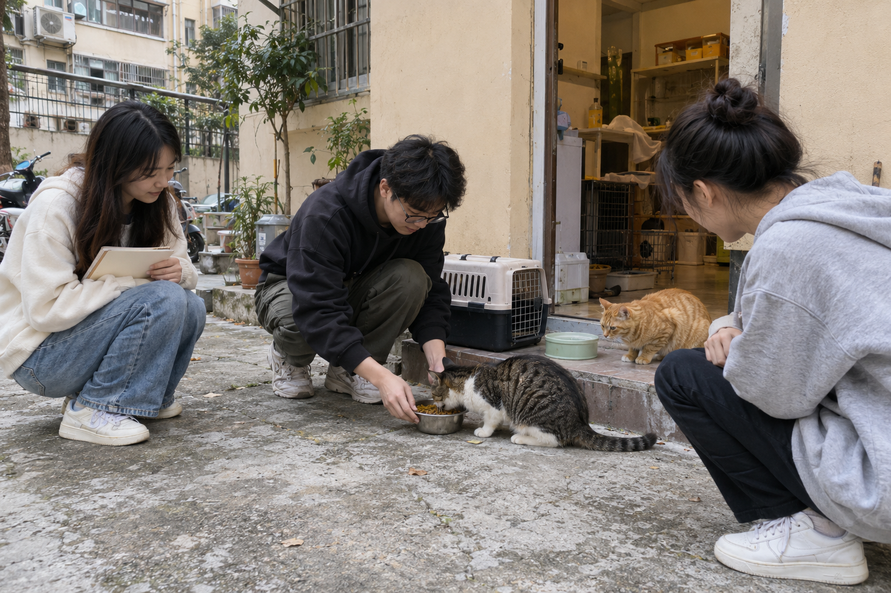

# 社区探访与场景素材

图片由AI生成，用于说明小组探访、喂养与观察的场景，不是项目实际活动的摄影记录。社区猫与寄养犬的配图采用普通居民楼和家庭背景，保留在产品界面素材中。

## 实地观察框架

| 观察对象 | 记录内容 | 可对应的产品字段 |
|---|---|---|
| 救助人员 | 线索来源、接待与分工方式 | 来源渠道、责任人 |
| 动物情况 | 外观、行为、救助方核验说明 | 动物档案、核验状态 |
| 日常照护 | 喂食饮水点、环境维护 | 照护说明与异常记录 |
| 后续联系 | 联系流程、回访约定 | 跟进状态与回访时间 |

真实访谈与活动记录应保留日期、经同意的受访角色和可核对的观察记录。这里提供观察框架，不虚构机构名单、合作家数或活动签到。
