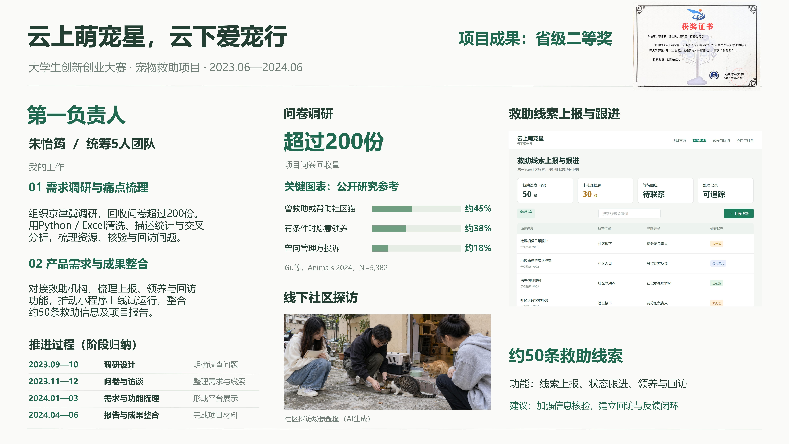
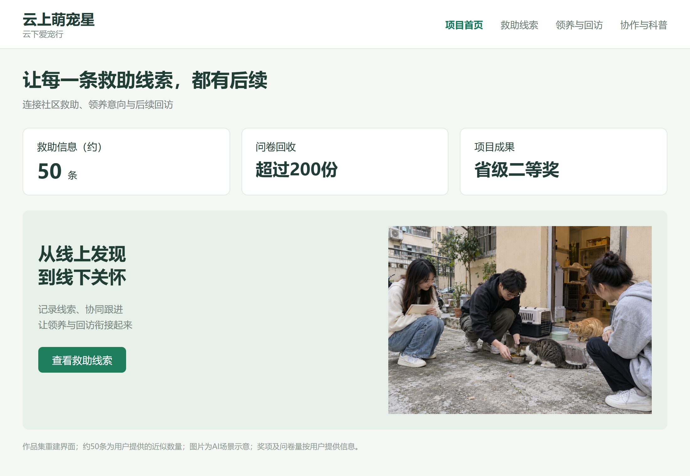
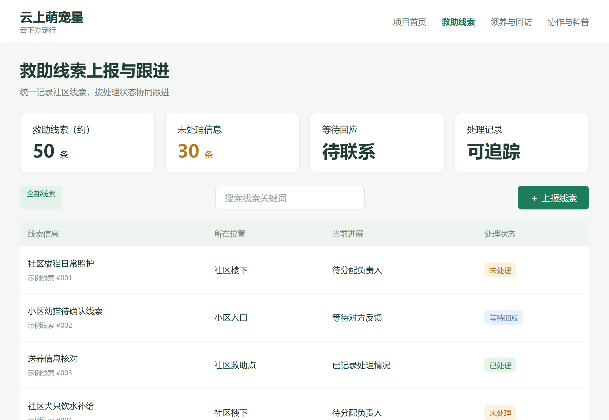
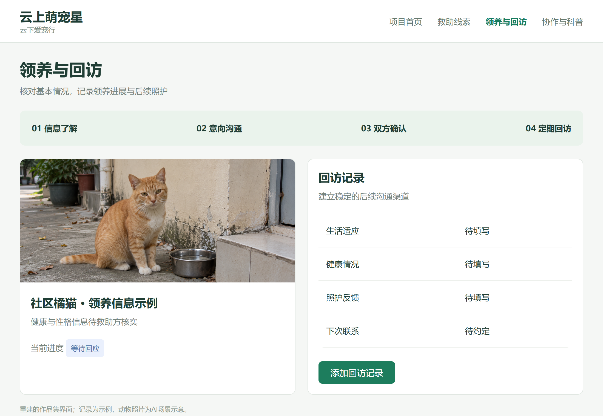
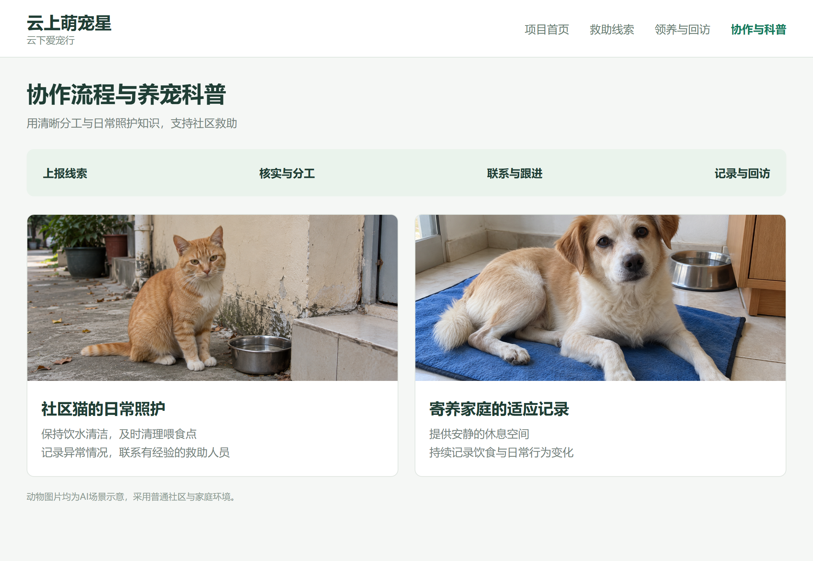

# 云上萌宠星，云下爱宠行

宠物救助项目作品集，重点展示作为第一负责人的需求调研、团队推进、产品需求梳理与成果整合。

**大学生创新创业大赛 · 项目负责人（5人团队） · 2023.06—2024.06 · 省级二等奖**



[下载最终可编辑PPTX](05-deliverables/project-overview-final.pptx) · [阅读简历分段表述](05-deliverables/resume-summary.md) · [查看结论与建议](05-deliverables/conclusions.md)

## 项目做了什么

1. **问卷与需求调研**：围绕京津冀宠物救助、领养与照护问题开展调研。项目问卷回收超过200份，梳理救助资源不足、信息核验与后续回访等问题。
2. **分析与设计依据**：按负责人提供的经历，使用Python / Excel完成清洗、描述统计与交叉分析。本仓库补充整理分析流程和公开研究数据复核，接入真实答卷后可复算项目统计。
3. **产品功能梳理**：按负责人提供的经历，对接救助机构并推动小程序试运行，梳理线索上报、处理状态、领养与回访功能。界面展示约50条救助信息的管理场景。
4. **成果整合**：完成项目总览PPT、界面截图、研究材料与建议。相关成果获得省级二等奖。

## 按过程浏览

| 文件夹 | 内容 | 对应产出 |
|---|---|---|
| [01-research](01-research/) | 问卷样本、访谈提纲、数据字段 | 调查问题与答卷模板 |
| [02-analysis](02-analysis/) | Python流程、Excel复核、公开研究数据 | 可追溯的数据与分析方法 |
| [03-product](03-product/) | 需求到功能映射、HTML界面与截图 | 产品展示与协作流程 |
| [04-fieldwork](04-fieldwork/) | 探访场景配图、观察框架 | 线下调研的展示素材 |
| [05-deliverables](05-deliverables/) | 最终PPTX、整页预览、结论与简历表述 | 集中展示项目成果 |

## 界面截图

| 项目首页 | 救助线索上报 |
|---|---|
|  |  |
| 领养与回访 | 协作与科普 |
|  |  |

## 数据与材料说明

项目回收量、团队人数、起止时间、区域、约50条救助信息及奖项按项目负责人提供信息整理。阶段月份为项目过程归纳，不作为逐月工作日志。

关键图表使用 Gu 等2024年发表的[中国城市社区猫研究](https://pmc.ncbi.nlm.nih.gov/articles/PMC10854670/)，在图内注明“公开研究参考”。它与本项目超过200份问卷的口径分开。未提供原始答卷和后台日志，不用外部研究替代项目统计，也不推断机构合作家数或运营提升率。数据分析和试运行经历按负责人最新文字描述，仓库文件不替代当年的过程记录。

本仓库中的问卷、访谈提纲与分析流程为作品集整理稿，不声称是当年归档的原始问卷。HTML为界面演示，未连接真实后台。宠物与探访照片为AI生成场景配图。奖状图片沿用负责人修改后的PPT。

## 本地查看与复算

下载仓库后打开 `03-product/ui/01.html` 查看界面。打开 `02-analysis/public-study-analysis.xlsx` 查看数据来源及计算公式。

```bash
cd 02-analysis
python analyze.py
```

脚本仅需Python 3标准库。可运行：

```bash
python analyze.py --responses ../01-research/responses-template.csv
```
